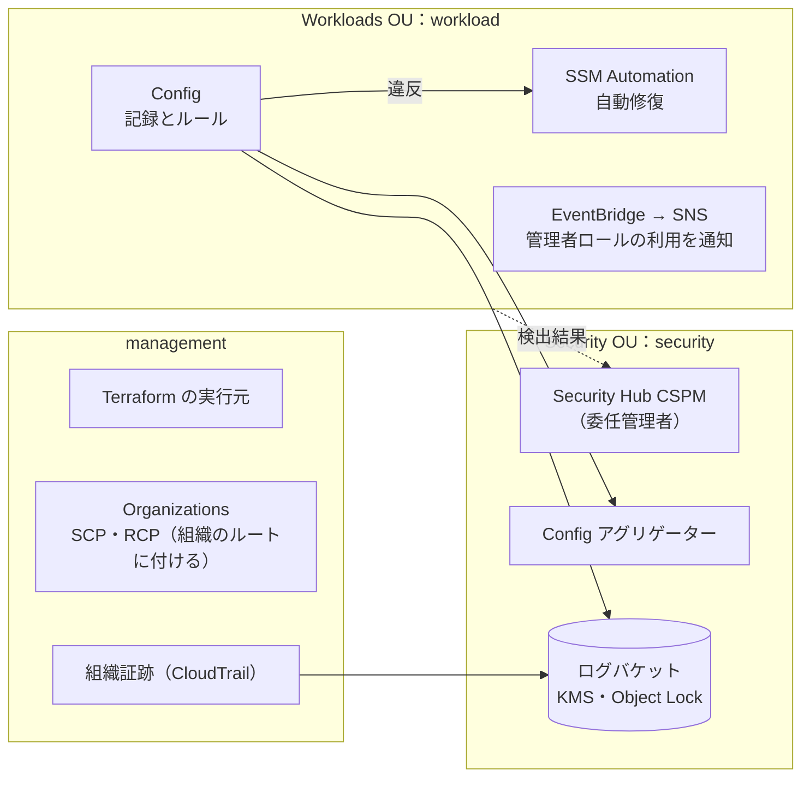

# guardrails

AWS のマルチアカウント環境に、金融機関向けの基準（FISC 安全対策基準、NIST SP 800-53、800-63B）を意識したガードレールを、Terraform で作る個人開発です。

12 の統制（C01〜C12）を、**防止・検知・修復・証跡**の4段階で実装しています。統制と実装の対応は `controls/controls.yaml` を正として管理し、表の生成と照合を CI で自動化しています。

> **状態（2026-11-22）**：コードと手元の検証までが終わったところです。AWS への適用、デモの実行、実測値はこれからです。
> この README で「未確認」「（実測後に記入）」と書いた箇所が、それに当たります。

---

## 何を作ったか

### アカウント構成



| アカウント | 役割 |
|---|---|
| management | 組織、SCP・RCP、組織証跡、予算アラート、Identity Center。Terraform はここから実行する |
| security | ログの保管（KMS で暗号化、Object Lock）、Config の集約、Security Hub CSPM の委任管理者 |
| workload | 守られる側。Config のルール、自動修復、デモを動かす。P3（AI エージェントの権限管理）もここで動かす |

### 4段階の実装

| 段階 | 使うもの | いつ効くか |
|---|---|---|
| 防止 | SCP・RCP、アカウントの既定設定、Checkov（CI） | 操作の前、またはプルリクエストの時点 |
| 検知 | Config ルール、Security Hub CSPM（NIST 800-53 の8コントロール） | 違反ができたあと |
| 修復 | SSM Automation（Config の自動修復） | 検知されたら自動で |
| 証跡 | 組織証跡（マルチリージョン、ログファイルの検証）、Config の記録 | あとで見返すとき |

### 12 の統制

| ID | 要件 |
|---|---|
| C01 | 利用リージョンを東京と大阪に限る（大阪は Bedrock の推論だけ） |
| C02 | 監査ログを止めさせない、消させない |
| C03 | 構成の記録を止めさせない |
| C04 | 保存データを暗号化する（EBS） |
| C05 | S3 を公開させない |
| C06 | 通信を暗号化する（S3 は TLS 必須） |
| C07 | 長期の認証情報を作らせない |
| C08 | 人のログインは MFA 必須 |
| C09 | メンバーアカウントのルートを使わせない |
| C10 | 管理用ポートを全世界に開けさせない |
| C11 | 違反を含む変更を反映させない |
| C12 | パスワードの規則（基準の衝突） |

統制ごとの実装（SCP の Sid、Config ルール、Checkov の ID など）と NIST の対応先は、[docs/mapping.md](docs/mapping.md) にあります。

---

## 設計判断

### 1. 統制の一覧を「正」にして、コードとのずれを CI で止める

`controls/controls.yaml` に、統制ごとの実装を `scp: C01DenyOutsideAllowedRegions` のように書いています。

- [scripts/gen_mapping.py](scripts/gen_mapping.py) が、この一覧から [docs/mapping.md](docs/mapping.md) を生成します。
- [scripts/check_mapping.py](scripts/check_mapping.py) が、一覧とコードを**両方向**で照合します。
  - 一覧に書いた Sid、ルール名、リソース、Checkov の ID が、コードに実在するか
  - コードにある、統制 ID で始まる Sid やルールが、一覧から漏れていないか
  - 名前に埋め込んだ統制 ID（`C04DenyXxx` の C04）が、書いた統制と一致するか

対応表は手で書くとすぐに古くなるので、ずれたら CI が失敗するようにしました。

### 2. SCP の例外は管理者ロール1つだけ。使われたら通知する

SCP の例外は `OrganizationAccountAccessRole` だけで、`aws:PrincipalArn` で判定します。Terraform はこのロールでメンバーアカウントを操作します。

例外があると、そのロールが抜け道になります。そこで、引き受けられたら EventBridge と SNS でメールが届くようにしました。Identity Center の管理者（AdministratorAccess）は例外に入れていないので、管理者権限を持っていても SCP で拒否されます。

### 3. SCP と RCP は組織のルートに付ける

OU ごとに分けると、付け忘れや付け間違いの余地が増えます。統制はすべてのメンバーアカウントで共通なので、ルートに付けています。SCP は management アカウントには効かないので、Terraform の実行は妨げません。

SCP は3本、RCP は1本です。SCP は1本 5,120 文字までで、いちばん長いものでも 1,200 文字ほどです（ログバケットの名前の長さで少し変わります）。

### 4. C06 の TLS 必須は RCP で、リソースの側から止める

SCP は、組織の中のプリンシパルの操作しか止められません。RCP は S3 バケットの側に効くので、組織の外からのアクセスにも効きます。

ただし、Config のルール `s3-bucket-ssl-requests-only` はバケットポリシーしか見ないので、RCP で防いでいても違反と出ます。ログバケットにはバケットポリシーでも TLS 必須を書きました。ほかのバケットで出たら、理由を付けて抑制します。

### 5. C10 は実行時に止められないので、CI と自動修復で挟む

「22 番を 0.0.0.0/0 に開ける」は、IAM の条件キーで開放先の CIDR を判定できないので、SCP では止められません。そこで次の2つで挟みます。

- **前**：Terraform の変更は Checkov で止めます（C11）。IPv6（`::/0`）にポート範囲で開ける規則を個別のリソース（`aws_vpc_security_group_ingress_rule`）で書くと、組み込みのチェックでは引っかからないことを、違反ありのサンプルで確かめました。この形はカスタムポリシーで補っています。
- **後**：コンソールなどで開けられたら、Config が検知し、SSM Automation が自動で閉じます。

閉じるまでの時間は、CloudTrail の記録から測ります（[scripts/measure_remediation.py](scripts/measure_remediation.py)）。

### 6. C12：CIS と NIST 800-63B-4 の衝突は、800-63B-4 に合わせる

CIS 系のルール（Config の `iam-password-policy` の既定値、Checkov の CKV_AWS_9〜15）は、大文字・小文字・数字・記号を求めます。一方で 800-63B-4 は、文字種の組み合わせ規則を課してはならないとしています。

800-63B-4 に合わせ、文字種は求めず長さ 15 文字以上を見る設定にし、Checkov の該当チェックは使いません。残る問題は次の2つで、残るリスクとして記録しています。

- 人が実際に使うのは Identity Center のパスワードで、文字種が必須かつ変更できないとされます（未確認）。ここは設定では解けないので、MFA 必須（C08）で補います。
- IAM のパスワードポリシーでは、800-63B-4 が求めるブロックリストとの照合ができません。

### 7. Checkov は統制に関係するチェックだけを有効にする

すべてのチェックを有効にすると、統制と関係ない指摘でマージが止まり、「失敗しても無視する」習慣がつきます。そこで [.checkov.yaml](.checkov.yaml) で 10 個（組み込み6、カスタム4）に絞りました。

チェックが本当に効くかは、違反ありと違反なしのサンプル（[tests/fixtures/](tests/fixtures/)）で確かめます。有効にした 10 個がすべて違反ありのサンプルで失敗し、違反なしのサンプルでは1つも失敗しないことを、CI で毎回確かめます。

### 8. 費用を抑えるための絞り込み

- **Config**：記録するのは8種類のリソースだけです（セキュリティグループ、EBS、S3、IAM、CloudTrail など）。
- **Security Hub CSPM**：既定の標準は無効にし、NIST 800-53 の 8 コントロールだけを有効にしました。
- **ログバケット**：Object Lock は学習用なので、ガバナンスモードで1日にしています。ログは30日で消します。
- **予算アラート**：月 20 ドルで、80% と予測 100% のときに通知します。

### 9. デモで環境が壊れないようにする

デモは「禁止した操作が拒否される」ことを見せます。もし SCP が効いていなければ、その操作が本当に実行されてしまいます。そこで、実行されても害のない操作だけを選びました。

- EC2 は `--dry-run` を付ける。
- 止める・消す操作は、存在しない名前を相手にする。
- 設定を変える操作は、今と同じ値を書く。
- IAM ユーザーの作成だけは、拒否されなかったら消す。

デモ5（違反を含むプルリクエスト）もマージは試さず、GitHub の判定が `BLOCKED` かどうかを見ます。

### 10. Terraform は5フォルダに分け、値は環境変数で渡す

`org`、`logging`、`detection`、`remediation`、`policies` の5つに分け、state も別にしています。壊したときの影響範囲を小さくし、apply の順番を明確にするためです。

[scripts/tf.sh](scripts/tf.sh) が、`shared.env` の値と org の出力（アカウント ID など）を `TF_VAR_<名前>` にして渡します。`-var-file` で共通のファイルを渡すと、使わない変数に警告が出るためです。

---

## 入れなかったもの

| もの | 理由 |
|---|---|
| Control Tower、Landing Zone Accelerator | SCP や Config などの仕組みが隠れてしまい、何をしているかを見せられないため。作られるものが多く、片付けにくいこともある |
| GuardDuty | 脅威の検知は、この基盤の目的（統制の防止・検知・修復）とは別のため。費用もかかる |
| ネットワーク設計 | 範囲外。デモはネットワークに依存しない形にした |
| 東京以外へのリソースの配置 | C01 で東京に限るため。大阪は Bedrock の推論先としてだけ使う |

---

## 残るリスクと未確認のこと

**設計上残るもの**
- C10：実行時の防止はありません。開けられてから閉じるまでの間（実測後に記入）は開いています。
- C12：Identity Center のパスワード規則と 800-63B-4 の衝突（設計判断6）。
- 管理者ロールの利用通知は、workload アカウントだけです。security アカウントでは通知しません。

**AWS に上げてから確かめること**
- Security Hub の集約設定（`linking_mode = "NO_REGIONS"`）が通るか。
- Object Lock 付きのバケットに、組織証跡が書き込めるか。
- ポート範囲（0〜1024 など）で開けたルールも、自動修復が閉じるか。
- 拒否のエラーに、止めた層（SCP、RCP）が書かれるか。
- STS のグローバルエンドポイントで引き受けられた場合も、東京の EventBridge で通知できるか。

---

## 実測値

| 項目 | 値 |
|---|---|
| C10 の自動修復にかかる時間 | 中央値（実測後に記入）、最大（実測後に記入）、回数（実測後に記入） |
| 月額費用 | （実測後に記入） |

---

## 使い方

### 手元で確かめる（AWS は使わない）

必要なもの：Terraform 1.11 以降、Python 3.12。

```bash
pip install -r requirements-dev.txt
```

CI と同じ確認を手元で回します。

```bash
terraform fmt -check -recursive terraform tests/fixtures
```

```bash
checkov -d terraform --config-file .checkov.yaml
```

```bash
python scripts/test_checkov_fixtures.py
```

```bash
python scripts/check_mapping.py
```

```bash
python scripts/gen_mapping.py --check
```

`terraform validate` は、各フォルダで `terraform init -backend=false` をしてから実行します（[.github/workflows/ci.yml](.github/workflows/ci.yml) を参照）。

### AWS に上げる

1. management アカウントを用意し、ルートに MFA を設定する。
2. IAM Identity Center を東京で有効にする（コンソールで行う）。このとき組織（Organizations）も一緒に作られる。
3. 自分のユーザーを作り、MFA を必須にする（C08）。management 用の権限セット（AdministratorAccess）を作って、自分に割り当てる。
   - Terraform の権限セット `GuardrailsAdmin` が割り当てるのは、security と workload だけです。Terraform を実行する management への入り口は、ここで手で作ります。
4. AWS CLI で management のプロファイルを作る（`aws configure sso`）。名前は `shared.env` の `AWS_PROFILE` に合わせる。
5. state を置く S3 バケットを作る（[terraform/backend.hcl.example](terraform/backend.hcl.example) にコマンドがある）。
6. 設定ファイルを見本からコピーして書く。どちらも git の管理外。
   - `terraform/backend.hcl`：state の置き場所
   - `terraform/shared.env`：メールアドレス、ログバケットの名前など
7. 手順2で作られた組織を、Terraform に取り込む。そのまま apply すると、Terraform が組織をもう一つ作ろうとして失敗するため。

   ```bash
   aws organizations describe-organization --query Organization.Id --output text
   ```

   ```bash
   scripts/tf.sh org import aws_organizations_organization.this <上で表示された o- で始まる ID>
   ```

8. 5フォルダを順に apply する。順番は org → logging → detection → remediation → policies。

   ```bash
   scripts/tf.sh all apply
   ```

9. `shared.env` に Identity Center のユーザー ID を書き、org をもう一度 apply する（security と workload への権限セットの割り当て）。

   ```bash
   scripts/tf.sh org apply
   ```

10. メンバーアカウントのルートの認証情報を消す（ルートアクセスの一元管理。C09）。
11. GitHub のブランチ保護で、CI の2つのジョブを必須にする（C11）。

### デモ

設定は `scripts/demo/demo.env` に書きます（[demo.env.example](scripts/demo/demo.env.example) をコピーする）。デモは Identity Center のプロファイルで実行します。管理者ロールは SCP の例外なので、拒否されずデモになりません。

| デモ | 統制 | 見せること |
|---|---|---|
| [demo1-region.sh](scripts/demo/demo1-region.sh) | C01 | 東京以外のリージョンが拒否される。大阪は Bedrock の推論以外が拒否される |
| [demo2-logging.sh](scripts/demo/demo2-logging.sh) | C02・C03 | ログと Config を止めることも、消すこともできない |
| [demo3-baseline.sh](scripts/demo/demo3-baseline.sh) | C04〜C07 | EBS の暗号化、S3 の公開ブロック、TLS 必須、IAM ユーザーの作成禁止を崩せない |
| [demo4-remediation.sh](scripts/demo/demo4-remediation.sh) | C10 | SSH を全世界に開けると、自動で閉じられる |
| [demo5-blocked-pr.sh](scripts/demo/demo5-blocked-pr.sh) | C11 | 違反を含むプルリクエストは、CI が失敗してマージできない |

`DRY_RUN=1` を付けると、AWS や GitHub を呼ばずに、実行するコマンドだけを表示します。

```bash
DRY_RUN=1 scripts/demo/demo1-region.sh
```

デモ4を何回か実行したら、修復にかかった時間を測ります。

```bash
python scripts/measure_remediation.py --profile guardrails-workload --hours 24
```

### 片付け

destroy はフォルダごとに、apply と逆の順番（policies → remediation → detection → logging → org）で行います。

- ログバケットは、Object Lock の期間（1日）が過ぎるまで消せません。
- org を destroy すると、アカウントを組織から外そうとします。

Config と Security Hub は動かしている間ずっと費用がかかるので、使わない間は detection を destroy します。

---

## ファイルの構成

```
controls/controls.yaml      統制の一覧（正）
docs/mapping.md             対応表（controls.yaml から生成する。手で編集しない）
terraform/
  org/                      組織、OU、アカウント、ルートアクセスの一元管理、予算、Identity Center
  logging/                  ログバケット、KMS キー、組織証跡
  detection/                Config、Config アグリゲーター、Security Hub CSPM、管理者ロールの利用通知
  remediation/              C10 の自動修復
  policies/                 SCP・RCP（scp/、rcp/ に JSON）、アカウントの既定設定（account_baseline/）
checkov/                    Checkov のカスタムポリシー（CKV2_GR_Cxx_n）
tests/fixtures/             Checkov のテスト用サンプル（bad：違反あり、good：違反なし）
scripts/
  tf.sh                     5フォルダを順に実行する
  check_mapping.py          controls.yaml とコードの照合
  gen_mapping.py            docs/mapping.md の生成
  test_checkov_fixtures.py  Checkov の各チェックが効くかの確認
  measure_remediation.py    C10 の修復にかかった時間の計測
  demo/                     デモ1〜5
.github/workflows/ci.yml    CI
```
